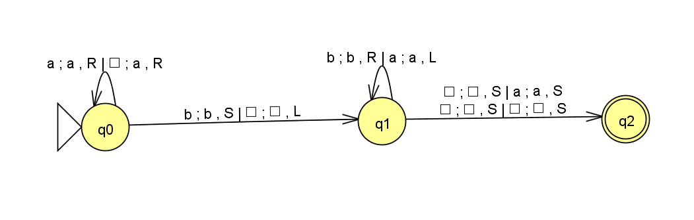
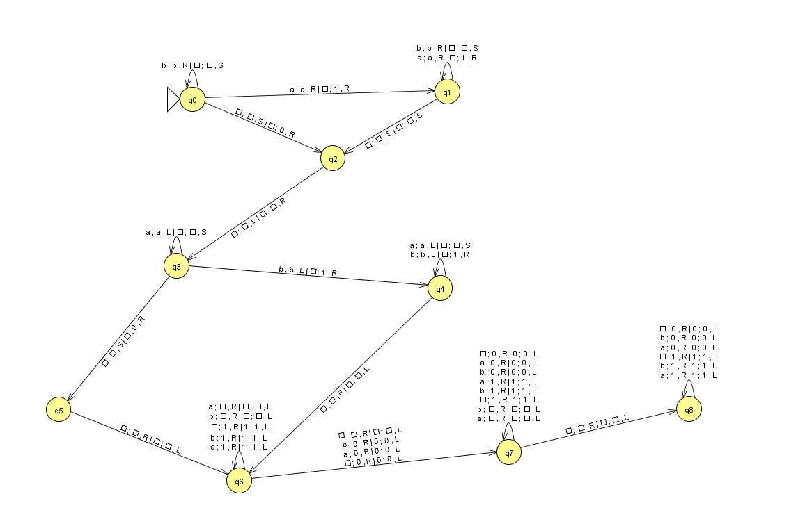

# Práctica 2 — Simulador de Máquina de Turing determinista multicinta

## Autor
- Nombre: Alejandro David Castro Afonso
- Asignatura: CC 26/27

## Opciones elegidas
- Escritura y movimientos **independientes** por cinta.
- Movimientos posibles: **L, R, S**.
- Cinta infinita en **ambas direcciones** (`std::map<long long, std::string>`).

## Requisitos
- C++17
- CMake ≥ 3.15

## Compilación
```bash
mkdir build && cd build
cmake ..
make
```

## Ejecución
```bash
build/turing -config <configuracion MT> -in <input>
```


### MT 1 



```bash
# MT1: L = { a^n b^m | m >= n, n > 0 }
# MT de 2 cintas
q0 q1 q2
a b
a b _
q0
_
q2
2

# q_origen leido1 leido2 q_destino escrito1 escrito2 mov1 mov2
q0 a _ q0 a a R R
q0 b _ q1 b _ S L
q1 b a q1 b a R L
q1 _ a q2 _ a S S
q1 _ _ q2 _ _ S S
```

### MT 2



```bash
# MT2: sustituir cadena por 1^(#b) _ 1^(#a)
# MT de 2 cintas
q0 q1 q2 q3 q4 q5 q6 q7 q8
a b
a b _ 1 0
q0
_
q0
2

# q_origen leido1 leido2 q_destino escrito1 escrito2 mov1 mov2
q0 b _ q0 b _ R S
q0 a _ q1 a 1 R R
q0 _ _ q2 _ 0 S R

q1 b _ q1 b _ R S
q1 a _ q1 a 1 R R
q1 _ _ q2 _ _ S S

q2 _ _ q3 _ _ L R

q3 a _ q3 a _ L S
q3 b _ q4 b 1 L R
q3 _ _ q5 _ 0 S R

q4 a _ q4 a _ L S
q4 b _ q4 b 1 L R
q4 _ _ q6 _ _ R L

q5 _ _ q6 _ _ R L

q6 a _ q6 _ _ R L
q6 b _ q6 _ _ R L
q6 _ 1 q6 1 1 R L
q6 b 1 q6 1 1 R L 
q6 a 1 q6 1 1 R L
q6 _ _ q7 _ _ R L
q6 b 0 q7 0 0 R L
q6 a 0 q7 0 0 R L
q6 _ 0 q7 0 0 R L

q7 _ 0 q7 0 0 R L
q7 a 0 q7 0 0 R L
q7 b 0 q7 0 0 R L
q7 b 1 q7 1 1 R L 
q7 a 1 q7 1 1 R L
q7 _ 1 q7 1 1 R L
q7 a _ q7 _ _ R L
q7 b _ q7 _ _ R L
q7 _ _ q8 _ _ R L

q8 _ 0 q8 0 0 R L
q8 a 0 q8 0 0 R L
q8 b 0 q8 0 0 R L
q8 b 1 q8 1 1 R L 
q8 a 1 q8 1 1 R L
q8 _ 1 q8 1 1 R L
```